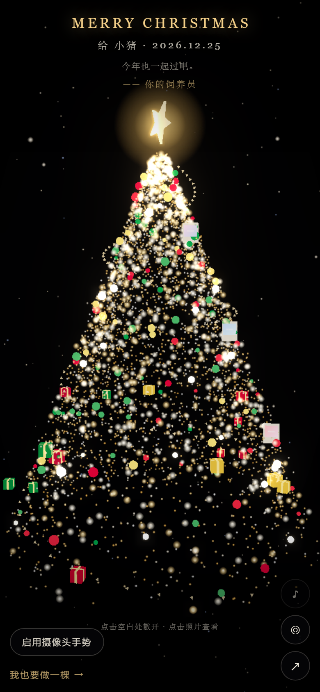
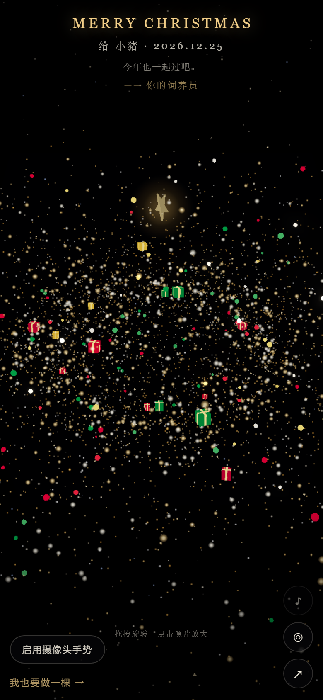
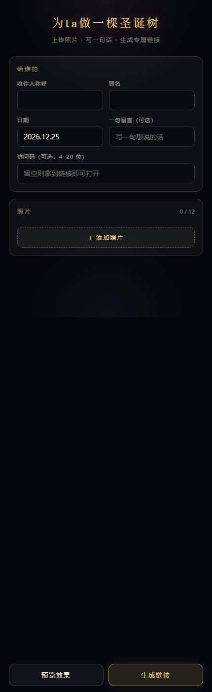
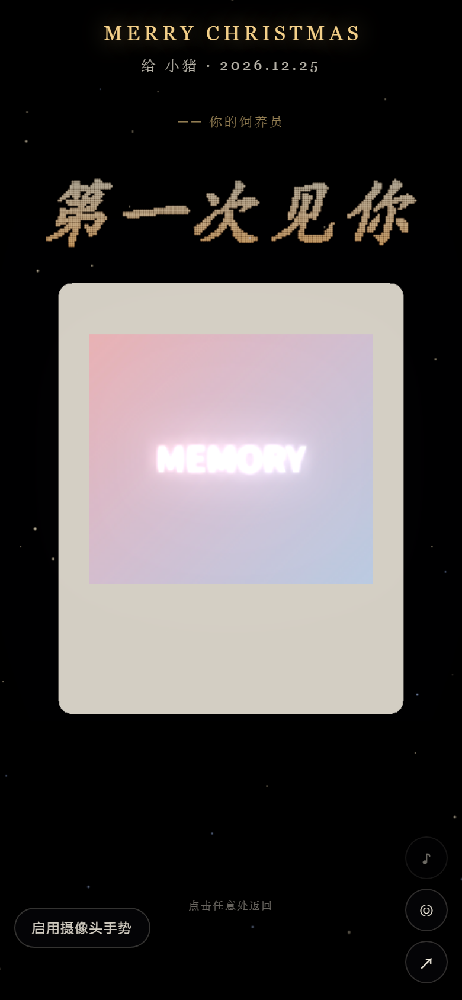

# 圣诞树礼物网页 · Winter Gift

一棵用粒子组成的圣诞树。上传照片、写一句话，生成一个只属于你们的链接；对方打开后可以张开手掌让树散开，点开照片时，照片对应的文字会由金色粒子汇聚而成。

## 在线体验

- **通用版（自己上传照片、生成链接）**：https://winter-gift.pages.dev
- **个人版（固定内容示例）**：https://xli98433-afk.github.io/winter-letter/
- 个人版仓库：[xli98433-afk/winter-letter](https://github.com/xli98433-afk/winter-letter)

## 效果









## 功能

- **3D 粒子圣诞树**：暖金灯光、红绿彩球、礼物盒、树顶星，Bloom 泛光与暗角。
- **手势交互**：MediaPipe Hands 识别张开 / 握拳 / 捏合；捏合可打开照片，没有摄像头时可用点击与拖拽。
- **绽放式散开**：点击后粒子平滑向四周绽开，整屏铺开。
- **照片**：上传后自动压缩；树上是挂饰，散开后飞成星云；点击照片进入特写。
- **每张照片一句文案**：特写时由粒子以参考版的手写艺术字（Segoe Script / Comic Sans，中文回退楷体）汇聚在照片上方。
- **个性化链接**：收件人称呼、署名、日期、留言；链接形如 `/?g=<12位ID>`。
- **二维码**：生成链接时同步生成二维码，方便当面扫。
- **动态分享卡片**：`/?g=<id>` 由服务端输出动态标题、描述和 OG 图；未加密礼物会使用浏览器生成的专属 1200×630 分享图。
- **访问码**：可选 4–20 位访问码；加盐哈希存储，照片使用 7 天有效的 HMAC 签名地址，不能靠猜路径直接访问。
- **自动过期**：配置与照片默认 90 天；每天每 IP 最多创建 5 份。
- **保存与分享**：保存当前画面、系统分享或复制链接、程序化背景音乐。

## 怎么用

1. 打开 https://winter-gift.pages.dev ，进入编辑器。
2. 上传 1–12 张照片（开通 R2 后最多 20 张），可调整顺序、逐张填写文案。
3. 填写收件人、署名、日期、留言；需要保密就设置访问码。
4. 点「预览效果」在本机查看，或点「生成链接」得到链接、二维码与访问码。
5. 把链接（和访问码，如有）发给对方。

接收方打开链接后：点空白处或张开手掌让树散开，点照片查看特写与粒子文案；握拳或再次点击返回。

## 技术栈

- **渲染**：Three.js 0.160、EffectComposer、UnrealBloomPass
- **手势**：MediaPipe Hands（按需从 CDN 加载，带多源回退）
- **前端**：原生 ES Modules，无构建步骤
- **后端**：Cloudflare Pages Functions
- **存储**：Workers KV（默认）；可选 Cloudflare R2 存照片
- **字体**：手写体 Segoe Script / Comic Sans + 楷体回退；编辑器分享图使用 Zhi Mang Xing
- **个人版托管**：GitHub Pages

## 目录结构

```
.
├─ index.html              接收页
├─ create.html             编辑器
├─ js/
│  ├─ main.js              场景、粒子、照片、手势、粒子文案
│  └─ editor.js            上传、压缩、预览、发布、二维码
├─ functions/
│  ├─ index.js             按 ?g= 输出动态 title / description / OG
│  └─ api/
│     ├─ gifts.js          创建礼物
│     ├─ gifts/[id].js     读取 / 删除，访问码校验与签名 URL
│     ├─ photos/[id]/[slot].js  照片输出（R2 或 KV）
│     └─ meta.js           返回当前存储上限
├─ lib/                    three、后处理、二维码（本地依赖）
├─ docs/                   README 截图
├─ wrangler.toml           Pages / KV 绑定
└─ deploy.ps1              构建 dist 并部署
```

## 本地运行

纯静态预览（发布按钮会回退到本机演示链接）：

```powershell
python -m http.server 8082
```

带后端与本地 KV（推荐）：

```powershell
npx wrangler pages dev . --port 8788 --kv GIFTS --persist-to .wrangler/state
```

打开 `http://127.0.0.1:8788/create`。摄像头手势需要 `localhost` 或 HTTPS；字体与手势库来自 CDN，离线时会回退到系统字体/点击模式。

## 部署

### Cloudflare Pages（通用版）

1. 创建 KV：`npx wrangler kv namespace create GIFTS`，把返回的 id 填进 `wrangler.toml`。
2. 创建 Pages 项目：`npx wrangler pages project create winter-gift --production-branch main`。
3. 运行 `deploy.ps1`（会重建 `dist` 并部署），或手动：
   `npx wrangler pages deploy dist --project-name winter-gift --branch main`。
4. 生产地址为 `https://<项目名>.pages.dev`。

### R2（可选，提升到 20 张照片）

1. 在 Cloudflare Dashboard 开通 R2（免费额度 10GB，可能需要绑定付款方式）。
2. 创建桶：`npx wrangler r2 bucket create winter-gift-photos`。
3. 在 `wrangler.toml` 增加：

```toml
[[r2_buckets]]
binding = "PHOTOS"
bucket_name = "winter-gift-photos"
```

4. 重新部署。`/api/meta` 会自动返回 20 张 / 1600px / 单张 4MB 的新上限，编辑器会跟着调整。

### 个人版（GitHub Pages）

个人版是同一套画面，内容写死在代码里，仓库见 [winter-letter](https://github.com/xli98433-afk/winter-letter)，由 GitHub Pages 托管。

## 数据与隐私

- 链接不可枚举，但拿到链接即可访问；需要更强隐私请设置访问码。
- 加密礼物的照片使用 HMAC 签名地址（7 天有效）；未加密礼物的照片按随机 ID 路径访问。
- 配置与照片默认 90 天过期；可由创建者用本地保存的 editToken 调用 DELETE 删除。
- 照片在浏览器端压缩后上传；KV 模式每人每天 5 份、最多 12 张；R2 模式最多 20 张。
- 没有账号系统；editToken 只保存在创建者当前浏览器，清除浏览器数据后无法再管理该礼物。

## 已知限制 / Roadmap

- 还没有「管理页」界面：删除接口已实现，编辑需要重新生成。
- 微信内自定义分享卡片需要认证公众号与 JS-SDK；目前只能做到动态标题、描述与部分客户端的 OG 图。
- 默认 KV 存储空间与单份照片数有限，长期使用建议开通 R2。
- 暂无自定义域名与访问统计。
- 字体、MediaPipe、二维码库来自第三方，遵循各自许可证。

## 字体与第三方

- [Three.js](https://threejs.org/)（MIT）
- [MediaPipe](https://developers.google.com/mediapipe)（Apache-2.0）
- [qrcodejs](https://github.com/davidshimjs/qrcodejs)（MIT）
- 编辑器分享图使用的 Zhi Mang Xing 通过 [Fontsource](https://fontsource.org/) 加载，遵循 SIL Open Font License。

---

用一张照片、一句话，做一棵只属于你们的树。
